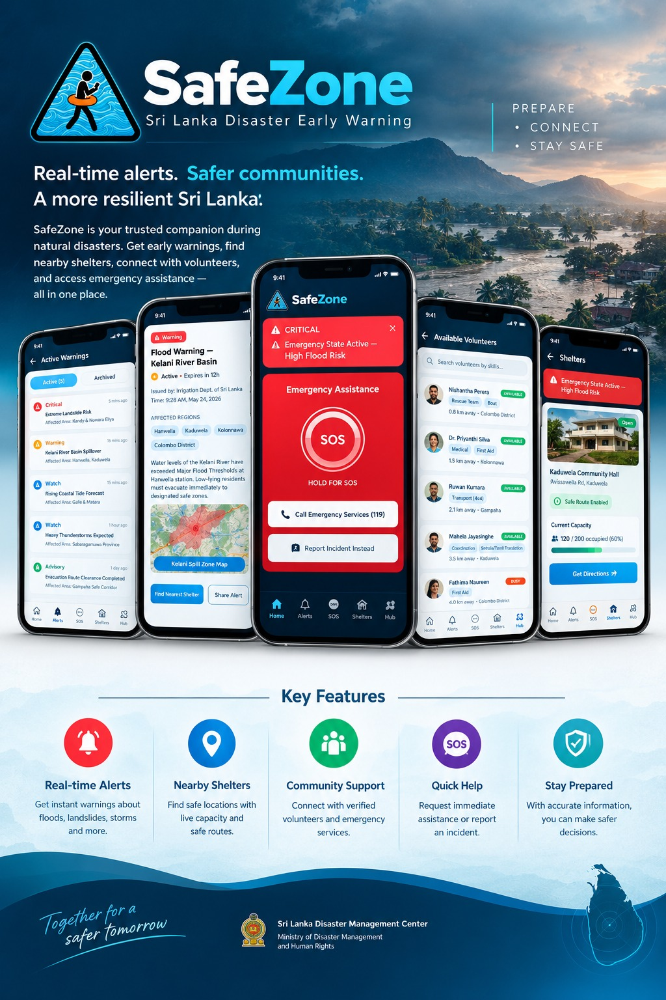

<div align="center">


# SafeZone

**Sri Lanka Disaster Early Warning** · *Prepare · Connect · Stay Safe*

Real-time alerts. Safer communities. A more resilient Sri Lanka.




</div>

---

## About

SafeZone is a Flutter app that gives people in Sri Lanka early warning of floods and other natural disasters, and gives authorities one place to broadcast and coordinate the response. Citizens get alerts, find the nearest open shelter, report incidents, and tell family they are safe. Authorities get a dashboard to send geo-targeted alerts, verify citizen reports and shelter submissions, and see who has been reached.

It is built on [Supabase](https://supabase.com) (Postgres + PostGIS, Auth, Realtime, Storage, Edge Functions) with an offline-first map layer, so the core safety information keeps working on a poor connection.

Built by **The Pioneers** for the Y3S2 UEE module.

## Features

### For citizens
- **Real-time alerts**: severity-banded warnings (green to red) delivered live. Critical red alerts use a dedicated alarm channel that can bypass Do Not Disturb, with SMS and in-app fallback if push fails.
- **Interactive map**: street and topographic layers, your live GPS position, shelters, incidents and active alert zones on one map. Maps are locked to Sri Lanka.
- **Incident reporting**: photo and video evidence, an SOS flag for life-threatening reports, community confirmation with a credibility score, and duplicate warnings for nearby reports. The pin starts on your GPS position and can be moved by hand.
- **Shelters**: capacity, occupancy, status, live supply levels (water, food, medicine, bedding), safe-route directions, a one-tap call to the shelter desk, and two-way messaging with the shelter manager (managers can also start a chat with their volunteers).
- **Manage your shelter**: run a shelter, relief camp or medical point? Submit it for verification. Once an authority approves it, it appears publicly and you manage its details, supplies and messages from the normal shelter page.
- **Volunteering**: sign up for tasks, see how many helpers each still needs, and withdraw yourself at any time.
- **Safety Circle and family invites**: one-tap "I'm Safe" broadcasts (with email), live ETA sharing, last-known-location markers, and invite links to add family.
- **Preparedness Hub**: disaster guides, evacuation routes and local disaster history.
- **Privacy and control**: onboarding with consent, a privacy settings screen, and in-app account deletion.
- **Accessibility and inclusion**: Sinhala, Tamil, Arabic (right-to-left) and English; light, dark and system themes; text scaling up to 2x; screen-reader support; captions for siren alerts; a Data Saver mode; optional vibration; and 44dp touch targets.

### For authorities
- **Broadcast dashboard**: create geo-targeted alerts by zone or by a point on the map (starting from your GPS position), with acknowledgement and delivery tracking.
- **Incident review**: verify or reject citizen reports.
- **Shelter submissions**: approve a submitted shelter or reject it with a reason the submitter sees.
- **Volunteer tasks**: post, edit, delete and move tasks through open, in progress and completed.
- **Feedback overview**: citizen ratings and needs, summarised by zone.
- **Account deletion requests** and a broadcast audit log.

## Tech Stack

| Area | Technology |
|---|---|
| App | [Flutter](https://flutter.dev) / Dart, [Provider](https://pub.dev/packages/provider) |
| Maps | [flutter_map](https://pub.dev/packages/flutter_map) with CARTO (street) and OpenTopoMap (topo) tiles, cached for offline use |
| Backend | [Supabase](https://supabase.com): Postgres with PostGIS and row-level security, Auth, Realtime, Storage |
| Edge Functions | Deno / TypeScript, with [Brevo](https://www.brevo.com) for transactional email |
| Device | `geolocator`, `flutter_local_notifications`, `connectivity_plus`, `image_picker`, `url_launcher`, `share_plus`, `app_links` |
| Routing | OSRM (configurable with `ROUTING_BASE_URL`) |

## Getting Started

### Prerequisites

- [Flutter SDK](https://docs.flutter.dev/get-started/install) (see `pubspec.yaml` for the Dart SDK constraint)
- A [Supabase](https://supabase.com) project with the core tables already created (`profiles`, `zones`, `alerts`, `incidents`, `shelters`, ...)
- A [CARTO](https://carto.com/basemaps) API key for street map tiles
- A [Brevo](https://www.brevo.com) account if you want email (confirmation, password reset, "I'm Safe")

### Setup

1. **Clone and install**
   ```bash
   git clone https://github.com/dulaj4067/Safe-Zone.git
   cd Safe-Zone
   flutter pub get
   ```

2. **Run the SQL migrations** in your Supabase project's SQL Editor, in this order (each is safe to re-run):

   | # | File | Adds |
   |---|---|---|
   | 1 | `sql/incident_migration.sql` | incidents, confirmations, credibility scoring, media storage bucket |
   | 2 | `sql/district_zones_migration.sql` | the 25 districts of Sri Lanka as zones |
   | 3 | `sql/safety_circle_migration.sql` | safety circle contacts, live ETA sharing, "I'm Safe" broadcasts |
   | 4 | `sql/safety_circle_consent_migration.sql` | consent for circle membership |
   | 5 | `sql/safety_circle_notify_trigger.sql` | circle request notifications (needs the Edge Function first) |
   | 6 | `sql/family_circle_invites_migration.sql` | family invite links |
   | 7 | `sql/coordination_features_migration.sql` | shelter supplies, volunteer tasks, messaging, feedback ([notes](docs/features/coordination_features.md)) |
   | 8 | `sql/security_hardening_migration.sql` | profile and PII lock-down, server-managed roles |
   | 9 | `sql/privacy_consent_onboarding_migration.sql` | policy acceptances, deletion requests, onboarding, alert engagement |
   | 10 | `sql/account_deletion_and_notifications_migration.sql` | deletion processing, duplicate-phone sign-ups, "I'm Safe" emails |
   | 11 | `sql/incident_delete_policy_migration.sql` | citizens can delete their own reports |
   | 12 | `sql/preparedness_hub_migration.sql` | optional Preparedness Hub repository sync |
   | 13 | `sql/shelter_workflow_and_volunteer_fixes_migration.sql` | shelter submit/approve workflow, owner management, volunteer withdrawal |
   | 14 | `sql/messaging_privacy_and_unread_migration.sql` | private message threads, manager-initiated chats, unread tracking |
   | 15 | `sql/deletion_email_confirmation_migration.sql` | emailed confirmation code for account deletion |

   `sql/cleanup_security_test_rows.sql` is a one-off clean-up of old test data, not part of the setup.

3. **Deploy the Edge Functions** (`supabase/functions/`):

   | Function | verify JWT | Purpose |
   |---|---|---|
   | `notify-safety-circle-request` | off | emails a circle request (called by a database trigger with a shared secret) |
   | `notify-im-safe` | off | emails circle members an "I'm Safe" notice |
   | `family-invite` | off | the page behind a family invite link |
   | `auth-callback` | off | the page behind email confirmation and password-reset links |
   | `process-account-deletion` | **on** | processes an account deletion once the emailed code is entered |
   | `send-deletion-confirmation` | **on** | emails the signed-in user a code to confirm deleting their account |

   Secrets: `BREVO_API_KEY`, `BREVO_SENDER_EMAIL`, `SAFETY_CIRCLE_WEBHOOK_SECRET`.

4. **Configure Supabase Auth.** Set a custom SMTP sender (Brevo) so confirmation and reset emails are delivered, and add the `auth-callback` URL under Redirect URLs.

5. **Configure the app.** Copy `config/dev.example.json` to `config/dev.json`:
   ```json
   {
     "CARTO_API_KEY": "your-carto-api-key",
     "SUPABASE_URL": "https://<project-ref>.supabase.co",
     "SUPABASE_PUBLISHABLE_KEY": "sb_publishable_...",
     "ROUTING_BASE_URL": "https://router.project-osrm.org"
   }
   ```
   Only ever use the **publishable** key. Every value here is compiled into the APK, and the app refuses to start with a secret or service-role key.

6. **Run it**
   ```bash
   flutter run --dart-define-from-file=config/dev.json
   ```

### Build an APK

```bash
flutter build apk --release --dart-define-from-file=config/dev.json
```

### Tests

```bash
flutter analyze lib test
flutter test
```

The suite covers validators, localization catalogs, layout at large text sizes in every language, accessibility semantics, the alert and incident flows, and the shelter approval model.

## Project Structure

```
lib/
├── l10n/         # Translation catalogs (English, Sinhala, Tamil, Arabic)
├── models/       # Data classes (Alert, Incident, Shelter, VolunteerTask, ...)
├── providers/    # App state (Alert, Incident, Safety, Accessibility, Auth, ...)
├── services/     # Supabase queries, notifications, location, tile caching
├── screens/      # Home, Incidents, Shelters, Settings, authority screens, ...
├── widgets/      # Reusable UI (markers, banners, sheets, a11y widgets)
├── modules/      # Self-contained feature modules (Preparedness Hub)
├── theme/        # Colours and typography, light and dark
└── utils/        # Validators, config, map tile setup, formatting

sql/              # Supabase migrations, run manually in the SQL Editor
supabase/functions/  # Edge Functions (Deno / TypeScript)
docs/             # Feature design notes and README images
videos/           # Investor pitch and technical demo videos
test/             # Unit and widget tests
```

## Security and Privacy

- Row-level security protects every table. Other people's phone numbers, roles and zones are not readable, and roles are managed on the server only.
- The app ships only the Supabase **publishable** key.
- Location is shared only with people you add to your Safety Circle, and only after they accept.
- Users can delete their account from the app (confirmed with a code sent to their email), and consent choices are recorded.
- Leaked-password protection in Supabase Auth requires a Pro plan and is off on the free tier.

## Known Limitations

- The Sinhala, Tamil and Arabic text is machine-drafted and needs a native-speaker review. Long legal text and a few secondary screens are English only.
- The Preparedness Hub stores guides, routes and history on the device rather than in Supabase.
- There are no push notifications yet for shelter messages or shelter approval decisions. Unread counts show inside the app only.
- Shelter approval is checked by an authority by hand; there is no automatic verification.

## Demo Videos

- [`videos/SafeZone_Investor_Pitch.mp4`](videos/SafeZone_Investor_Pitch.mp4)
- [`videos/SafeZone_Technical_Demo.mp4`](videos/SafeZone_Technical_Demo.mp4)

## Team: The Pioneers

- Dulaj Serasinghe
- Dewmini Rathnayake
- Dinuka Malliyawatta
- Dewmina Wanninayake

---

<div align="center">

*Together for a safer tomorrow.*

</div>
